<p align="center">
  <picture>
    <source media="(prefers-color-scheme: light)" srcset="docs/media/banner-light.gif">
    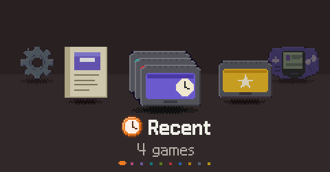
  </picture>
</p>

<h1 align="center">Torii</h1>

<p align="center">
  <b>A new kernel for the EZ-Flash Omega Definitive Edition.</b><br>
  Save states, cheats in every format, box art, themes and languages,<br>
  on a menu that runs at 60 fps.
</p>

<p align="center">
  <a href="https://github.com/ErikBavenstrand/torii-kernel/releases/latest"></a>
  <a href="https://github.com/ErikBavenstrand/torii-kernel/releases"></a>
  <a href="https://github.com/ErikBavenstrand/torii-kernel/actions/workflows/ci.yml"></a>
  <a href="THIRD_PARTY_NOTICES.md"></a>
</p>

<p align="center">
  <a href="#install">Install</a> ·
  <a href="#features">Features</a> ·
  <a href="#troubleshooting">Troubleshooting</a> ·
  <a href="CHANGELOG.md">Changelog</a>
</p>

Torii replaces the menu on your Omega DE. It starts from EZ-Flash's official
1.06 source, fixes the bugs that cost people their saves, and adds the things
the stock kernel never had: save states, an in-game menu, a cheat engine that
reads every common code format, box art, slots and backups for every save, and
a menu you can read in your own language.

Torii is the name of the gate at a Shinto shrine, the one you walk through into
another world. That felt right for something you pass through on the way to
every game.

> [!WARNING]
> Torii is for the **EZ-Flash Omega Definitive Edition** only. Don't flash it
> to the original Omega or any other cart. Never install v0.2.1 or v0.2.2: they
> can erase the cart's boot loader ([recovery](docs/recovery.md)).

<table>
  <tr>
    <td width="50%">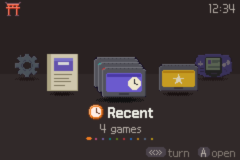</td>
    <td width="50%">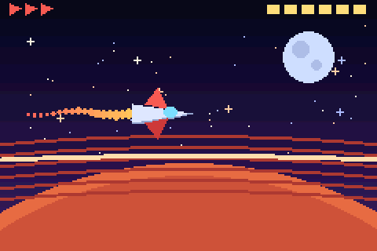</td>
  </tr>
  <tr>
    <td align="center"><sub>Your library, with covers, favourites and recents</sub></td>
    <td align="center"><sub>Save states from the in-game menu</sub></td>
  </tr>
  <tr>
    <td>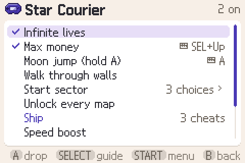</td>
    <td>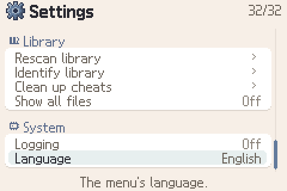</td>
  </tr>
  <tr>
    <td align="center"><sub>Cheats: pick them, or type your own</sub></td>
    <td align="center"><sub>Switch language without restarting</sub></td>
  </tr>
</table>

## What you get

- **Save states and an in-game menu.** Hold L+R+START in any GBA game: save or
  load a state, toggle cheats, take a screenshot, reset, sleep, or go back to
  the menu.
- **Saves you don't lose.** Every save is copied to the card with backups, up
  to 16 slots per game, and a trash folder that keeps deleted saves for 30 days.
  The copy survives a power cut at any step.
- **Every cheat format.** GameShark, Action Replay (v1/v2 and v3), CodeBreaker
  and VBA/AnyGBA codes, all run the way mGBA runs them. Game Genie and
  GameShark for Game Boy, Game Boy Color and NES games too.
- **Cheat search.** Find a value in a running game (lives, money, a timer) and
  turn it into a cheat, Action Replay style.
- **Box art.** A cover for every official GBA, GB and GBC game, offline, and
  your own pictures for romhacks and homebrew.
- **A menu worth looking at.** 60 fps tile engine, light and dark themes,
  favourites, recents, A-Z jumps, your own names for games.
- **Languages.** English and Swedish today, with packs anyone can make. File
  names show in Latin, Greek, Cyrillic and Vietnamese scripts.
- **GB, GBC and NES built in**, with save slots and cheats.

## Install

1. Download `ezkernelnew.bin` from the
   [latest release](https://github.com/ErikBavenstrand/torii-kernel/releases/latest).
2. Copy it to the root of your SD card.
3. Hold **R** while you switch the GBA on, and confirm the update.

That's it. Your games, saves and NOR games stay where they are. Put games
(`.gba`, `.gbc`, `.gb`, `.nes`) anywhere on the card, in any folders you like;
Torii finds them on its next start. The card can be FAT32 or exFAT.

<details>
<summary><b>Updating to a newer version</b></summary>

Do the same again: copy the new `ezkernelnew.bin` over the old one and hold R
at power-on. Settings, favourites, names and everything else in `/torii` carry
over. If you use a language pack, copy the packs from the same release too
(see [Languages](#languages)).

</details>

<details>
<summary><b>Going back to the official kernel</b></summary>

Download EZ-Flash's `ezkernelnew.bin` (1.06) from
[their repository](https://github.com/ez-flash/omega-de-kernel), copy it to the card's root and
hold R at power-on. Torii's `/torii` folder can stay; the official kernel
ignores it. Saves Torii copied to `/torii/saves` stay there, so copy the ones
you want back next to their games as `.sav` files.

</details>

<details>
<summary><b>What Torii keeps on the card</b></summary>

Everything lives in `/torii`. Keep the folder when you move to a new card.

| Path | What's in it |
|---|---|
| `saves/`, `backups/`, `trash/` | Your saves, their backups, and deleted slots (30 days) |
| `states/`, `screenshots/` | Save states and BMP screenshots |
| `cheats/` | One `.cht` file per game, named after the game's path |
| `art/`, `art.pak` | Covers: matched art, your own (`art/custom`), and the art pack |
| `lang/` | Language packs (`.lng`) |
| `names.db`, `names.txt`, `crc.txt` | Game names from No-Intro, and the ones you gave |
| `recent.txt`, `favorites.txt` | Your recents and favourites |
| `logs/` | Logs, when Logging is on |

</details>

## Features

### Save states and the in-game menu

<p>
  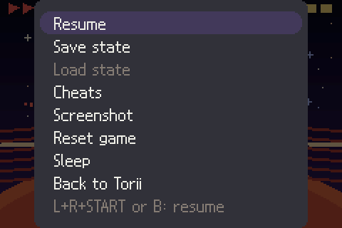
  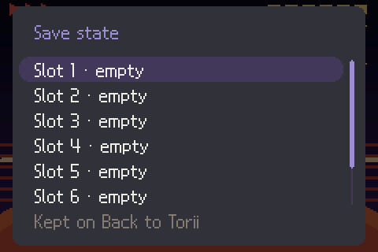
  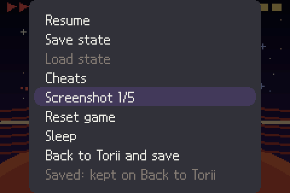
</p>

Hold **L+R+START** in a GBA game to open the menu. It opens in two frames and
gives the game back exactly as it was. From there you can save and load states
(8 per save slot), turn cheats on and off, run a cheat search, take up to five
screenshots, reset the game, or put the console to sleep.

<details>
<summary><b>How to use it</b></summary>

1. Turn on **Settings → Games → Save states**.
2. Start a game. GBA games need to start *with addons*, which is the default
   (Settings → Games → GBA boot mode).
3. Hold L+R+START. Pick **Save state**, then a slot.
4. Choose **Back to Torii** when you're done. That's when states and
   screenshots are written to the card.

States and screenshots stay in the cart until Back to Torii, so switching off
before that loses them. The game's own save is never at risk. To load a state
later, open the game's menu in Torii (START on the game) and pick
**Load state**. Change the hotkeys in **Settings → Hotkeys**.

</details>

### Saves you can trust

<p>
  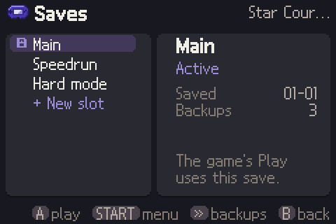
  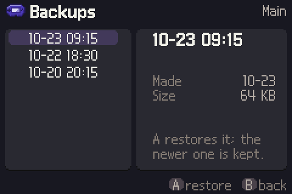
</p>

Each game gets up to 16 save slots, so you can keep a second playthrough or a
friend's file without overwriting yours. Every time a save is copied to the
card, the previous one becomes a backup you can restore with one press. Deleted
slots wait in a trash folder for 30 days.

The copy from the cart to the card is written so that a power cut at any moment
leaves you with either the old save or the new one, never a broken file. Torii
also fixes the official kernel's save bugs: small `.sav` files losing data,
32 KB Game Boy saves (Pokémon Gold, Silver, Crystal and Yellow) lost at power-off,
wrong save types for Doom, Doom II and the Classic NES Series, and a read
error writing over a good save.

<details>
<summary><b>Slots, backups and the trash</b></summary>

- START on a game → **Saves** lists its slots. A plays a slot and makes it the
  one Play uses. RIGHT shows its backups.
- **+ New slot** starts an empty save, copies the active one, or imports a
  `.sav` file.
- A game with two or more slots asks which to play when it starts. Turn that
  off in Settings → Saves → Ask for a slot; holding SELECT as you press A still
  asks.
- Settings → Saves → Backups kept sets how many backups each slot keeps.
- Settings → Saves → Clean up saves finds saves whose game is gone and empties
  the trash.

</details>

### Cheats

<p>
  
  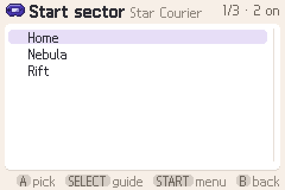
  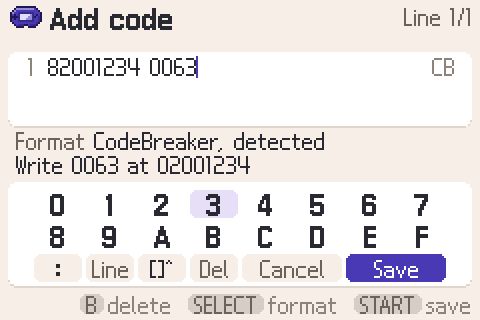
</p>

Torii runs every kind of GBA code: writes, fills, slides, pointers, conditions
with else blocks, button codes and ROM patches. The keypad tells you the
format it detected and what the code does before you save it. Long lists stay
tidy: headings you can jump between with L and R, and runs of the same cheat
with different values folded into one row of choices.

| Device | Formats |
|---|---|
| GBA | GameShark / Action Replay v1 and v2, Action Replay v3, CodeBreaker, VBA `address:value`, AnyGBA's extensions, [Torii code](docs/torii-code.md) |
| Game Boy, Game Boy Color | Game Genie, GameShark |
| NES | Game Genie, `address:value` |

<details>
<summary><b>Getting cheat files</b></summary>

Each game's cheats are in `/torii/cheats`, in a file named after the game,
in libretro's `.cht` format: `/GBA/Golden Sun.gba` reads
`/torii/cheats/GBA/Golden Sun.cht`. Any RetroArch cheat file works if you
rename it.

To fill a whole card at once, the [PC tools](#pc-tools) write cheat files
for every GBA game from [GameHacking.org](https://gamehacking.org), matched
to your exact ROM by its CRC:

```bash
just cheats /Volumes/OMEGA
```

</details>

<details>
<summary><b>Typing a code on the cart</b></summary>

1. START on a game → **Cheats** → **+ Add code** (the last row).
2. Type the code with the D-pad and A. L and R move between lines; **Line**
   starts a new one.
3. The line under the code says the format it detected and what the code
   does. SELECT forces a format if the guess is wrong.
4. START saves it, then name it with the keyboard.

A cheat with blanks in it (`00??`) opens the keypad with the blanks marked.
A greyed cheat says why it can't run on this cart.

</details>

<details>
<summary><b>Cheat search</b></summary>

<p>
  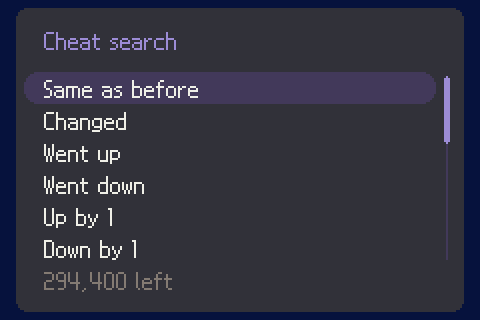
  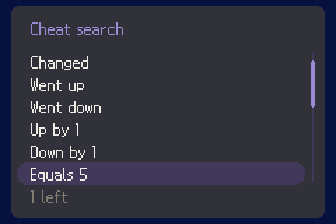
  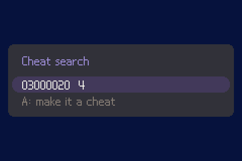
  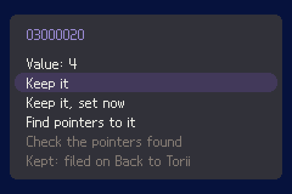
</p>

Say you want infinite lives and no code exists for your game.

1. Turn on Save states (the search uses their memory), start the game, and
   open the in-game menu. Pick **Cheat search** → **Start search**.
2. Lose a life. Open the search again and pick **Went down**, or
   **Equals 2** if you know the number.
3. Repeat until only a few values are left, then **Show them**.
4. Pick one, set it to 9 and **Keep it**. It's on right away, and after Back to
   Torii it's in the game's cheat list as "Found".

It also handles 8, 16 and 32-bit values, signed numbers, BCD scores, undo, and
pointer scans for values that move around in memory.

</details>

### Box art and your own pictures

<p>
  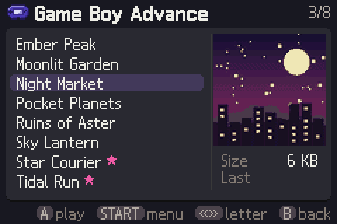
  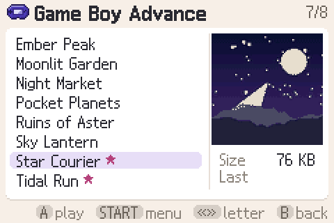
</p>

Turn on **Settings → Look → Game view → List + art** to see covers next to your
games. Official games are matched by CRC, so the cover is right even when the
file name isn't. Romhacks, translations and homebrew get whatever picture you
give them.

<details>
<summary><b>Covers for every official game</b></summary>

Build the art pack once with the [PC tools](#pc-tools). It holds a cover for
every No-Intro GBA, GB and GBC game (about 15 MB) and lives on your card, so
games you add later get their cover without a PC:

```bash
just art-pack /Volumes/OMEGA
```

</details>

<details>
<summary><b>Your own picture for a game</b></summary>

1. Put a picture (PNG, JPEG, anything common) named after the game's file in
   `/torii/art/custom-src` on the card: `Pokemon Prism.png` for
   `Pokemon Prism.gbc`.
2. Run `just art-add /Volumes/OMEGA`.

It's cropped to a square and converted to the GBA's colours. Your picture wins
over any matched cover.

</details>

### Game Boy, Game Boy Color and NES

<p>
  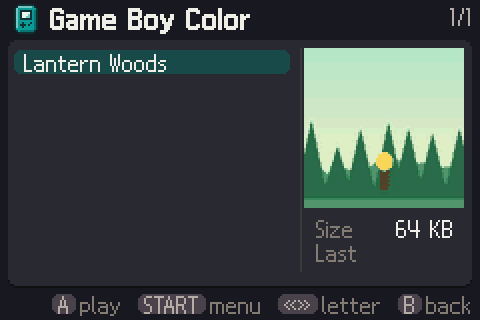
  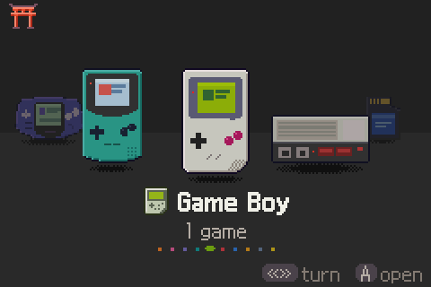
  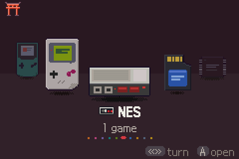
</p>

GB and GBC games run on [Jagoomba Color](https://github.com/EvilJagaGenius/jagoombacolor),
NES games on [PocketNES](https://github.com/Dwedit/PocketNES), both built into
the kernel. They start straight away (no boot menu), keep their settings and
palette between launches, get save slots like GBA games, and take Game Genie
and GameShark codes. Hold L and R together in game for the emulator's own menu
and its save states.

### Languages

<p>
  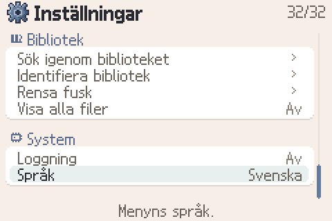
  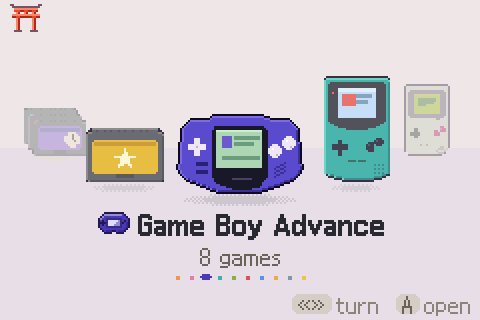
</p>

The menu speaks English and Swedish, and switches the moment you pick one.
Game and file names show in their own script: Latin, Greek, Cyrillic and
Vietnamese are built in.

<details>
<summary><b>Installing a language</b></summary>

1. Download `torii-lang.zip` from the same release as your kernel.
2. Copy its `.lng` files to `/torii/lang` on the card (make the folder if
   needed).
3. Pick the language in **Settings → System → Language**.

Use packs from the same release as the kernel. Any text a pack doesn't have
shows in English.

</details>

<details>
<summary><b>Making a language pack</b></summary>

1. Copy [`lang/en.ini`](lang/en.ini) to `lang/<code>.ini` (`de`, `pt-BR`...),
   and set `code` and `name` under `[meta]`.
2. Translate each text after its `=`. Keep `{1}`-`{9}`, `\n` and the
   `.one`/`.other` pairs as they are. [`lang/sv.ini`](lang/sv.ini) is a
   finished example, and the top of [`tools/lang.py`](tools/lang.py) explains
   the format.
3. Run `just lang` to check it and build `dist/lang/<code>.lng`.
4. Copy the pack to `/torii/lang` and look at every screen. Text that runs too
   long is cut with "...".

A pack can also bring a font for a script the menu doesn't cover.

</details>

### Themes and settings

<p>
  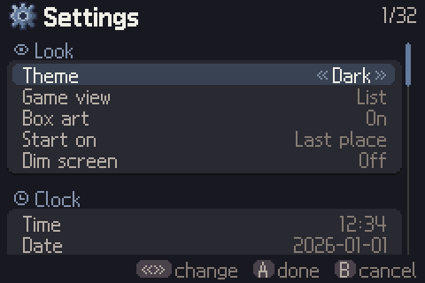
  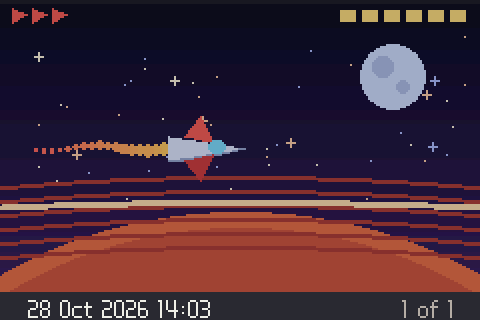
</p>

Light paper or dark graphite, previewed live as you change it. Settings is one
scrolling page, grouped into Look, Clock, Games, Saves, Cart, Hotkeys, Library
and System, with L and R to jump between groups. Screenshots you take in game
open in a built-in viewer from the game's menu or the SD card page.

<details>
<summary><b>Everything else</b></summary>

- **Favourites and recents** on the home carousel; R on a game toggles a favourite.
- **Rename** any game with the on-screen keyboard. The file stays as it is.
- **No-Intro names** for official games, so `pkmn_e.gba` lists as
  Pokémon Emerald (`just names-update`).
- **SD card page** to browse folders, with Write to NOR, Rename and Delete.
- **NOR page** for the cart's 64 MB of game NOR.
- **Clock**: set the time, 24-hour display, and separate switches for the
  clock and rumble.
- **Start on**: pick which home item faces you at power-on.
- **Controls and Questions pages** under Info, so the help is on the cart.

</details>

## Troubleshooting

<details>
<summary><b>The in-game menu doesn't open</b></summary>

It only opens in GBA games started *with addons*: check Settings → Games → GBA
boot mode, and the game's own Boot mode under its Game info. Settings →
Hotkeys → In-game menu set to **Auto** opens it only when save states are on
or cheats are picked. A game written to NOR keeps the hotkeys it was written
with.

</details>

<details>
<summary><b>A save isn't on the card</b></summary>

Games save to the cart first. Torii copies the save to the card the next time
it starts, after you play. If you answered No to *Save to SD card?*, it stays
in the cart until the next start.

</details>

<details>
<summary><b>Cheats do nothing</b></summary>

They run only when the game starts with addons (see above). Cheats that patch
the ROM don't run in games written to NOR.

</details>

<details>
<summary><b>A game won't start</b></summary>

- *File fragmented*: copy the game to the card again.
- *Path too long*: move the game to a shorter folder.
- A ROM over 32 MB has to be written to NOR (START on it in the SD card page).

</details>

<details>
<summary><b>Logs and Diagnostics</b></summary>

- **Logs:** set **Settings → System → Logging** to Errors, Info or Debug.
  Torii then writes what it does to `/torii/logs`. Attach those files when you
  report a bug. A crash is kept in cart memory and logged at the next start,
  even with Logging off.
- **Diagnostics:** Info → Diagnostics, or hold **L+R+SELECT** while switching
  on, even when the menu won't start. It runs Torii's self-tests and hardware
  checks.

</details>

<details>
<summary><b>The cart starts in safe mode, or says <code>No_Loader_found</code> or <code>Bad NOR ID</code></b></summary>

See [docs/recovery.md](docs/recovery.md). It walks through restoring
EZ-Flash's boot loader from a computer, and explains carts whose loader says
`Bad NOR ID`, which can't take any kernel update.

</details>

Found a bug? [Open an issue](https://github.com/ErikBavenstrand/torii-kernel/issues)
with your logs and what you did.

## PC tools

Optional helpers that run on your computer and prepare a card: names, covers
and cheats for everything on it in one go. They need
[just](https://github.com/casey/just) and [uv](https://docs.astral.sh/uv/),
and a clone of this repository.

```bash
just card /Volumes/OMEGA ~/Games/*.gba
```

copies the games, then names them, converts your pictures, fetches covers and
writes cheat files. Each step also runs on its own:

| Command | Does |
|---|---|
| `just names-update CARD` | No-Intro names for the card's games |
| `just names-add CARD names.tsv` | Your own names for many games at once |
| `just art-pack CARD` | Covers for every official GBA, GB and GBC game |
| `just art-add CARD` | Your pictures in `/torii/art/custom-src` as covers |
| `just cheats CARD` | Cheat files from GameHacking.org |
| `just library-report CARD` | Games still missing a name or cover |
| `just logs CARD` | Reads a card's logs into `dist/logs/torii.log` |

Covers and cheats are downloaded on your computer for your own card. None are
included in Torii.

## Building from source

Torii builds with devkitARM in Docker, so you need Docker and just (on macOS,
[colima](https://github.com/abiosoft/colima)). Then:

```bash
just build    # dist/ezkernelnew.bin
just play     # run it on an emulated Omega DE (needs CMake, pkg-config and SDL2)
just test     # unit tests, golden screens and games through the kernel
```

The build is reproducible, and every change is tested on an emulated Omega DE
built into mGBA. `just --list` shows every command, and
[docs/research/omega-de-hardware.md](docs/research/omega-de-hardware.md)
documents the cart. The README's pictures come from `just media`, on homebrew
stand-ins with made-up names.

## Credits

- [EZ-Flash](https://www.ezflash.cn) for the Omega DE and the 1.06 kernel source Torii is built on.
- [Jagoomba Color](https://github.com/EvilJagaGenius/jagoombacolor) by Jaga and [PocketNES](https://github.com/Dwedit/PocketNES) by Dwedit, from Goomba.
- [Galmuri](https://github.com/quiple/galmuri) by Lee Minseo, the menu's fonts (SIL OFL).
- [KyleBing's retro game console icons](https://github.com/KyleBing/retro-game-console-icons) (CC BY 4.0), the outlines of the console pictures.
- [FatFs](http://elm-chan.org/fsw/ff/), libgba, minilzo and [mGBA](https://mgba.io).

## Licence

Torii's own code is Apache 2.0, like EZ-Flash's kernel. The release binary
also contains GPL and LGPL code, so it is distributed under the GNU GPL 3 or
later. [THIRD_PARTY_NOTICES.md](THIRD_PARTY_NOTICES.md) lists every part and
its licence. Torii isn't made or endorsed by EZ-Flash, and no games, BIOS, box
art or cheat databases are included.
