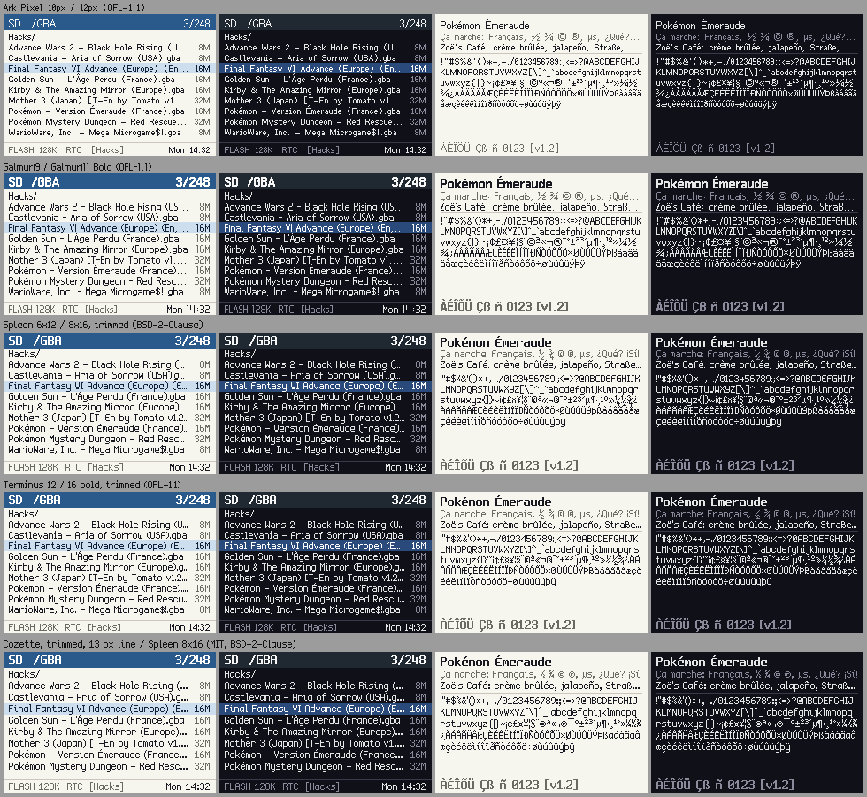

# Menu fonts for v0.3

Researched on 2026-10-19 for the v0.3 renderer (`docs/plans/roadmap.md`): a body font on a 12 px
line and a heading font on a 16 px line, 1bpp with a width table, covering Latin-1.
`tools/font.py` converts them to C, and `tools/font_preview.py` draws the sheets below
(`just font-preview`).

**Recommendation: Galmuri9 for body text and Galmuri11 Bold for headings** (OFL-1.1). The
pick is the user's; the sheets show all five pairs.

## Preview

[`fonts/sheet.png`](fonts/sheet.png) shows every pair at the GBA's 240x160, and
`fonts/KEY@3x.png` shows one pair at 3x: [ark](fonts/ark@3x.png),
[galmuri](fonts/galmuri@3x.png), [spleen](fonts/spleen@3x.png),
[terminus](fonts/terminus@3x.png), [cozette](fonts/cozette@3x.png). Each row has an SD list
(heading font in the title bar, body font for names, sizes and the status line) and a sample
screen (a heading, accented body text and every Latin-1 character), in a light and a dark
palette. The text is drawn from the packed bitmaps the kernel would get, with colours cut to
the GBA's 5 bits a channel.

## Candidates

| pair | licence | line px (body / heading) | mean a-z advance px | "Pokémon - Version Émeraude (France).gba" px | bytes in ROM (body / heading) | squeezed | clipped |
|---|---|---|---|---|---|---|---|
| Ark Pixel 10px / 12px proportional | OFL-1.1 | 12 / 16 | 5.0 / 5.8 | 199 | 3984 / 4546 | Å | Çç |
| Galmuri9 / Galmuri11 Bold | OFL-1.1 | 12 / 16 | 5.5 / 7.4 | 212 | 4356 / 5188 | none | ¡µ¿Çç |
| Spleen 6x12 / 8x16, trimmed | BSD-2-Clause | 12 / 16 | 5.7 / 7.6 | 218 | 2806 / 3147 | none | none |
| Terminus 12 / 16 bold, trimmed | OFL-1.1, Reserved Font Name | 12 / 16 | 5.7 / 7.7 | 215 | 2786 / 3094 | none | none |
| Cozette, trimmed / Spleen 8x16 | MIT / BSD-2-Clause | **13** / 16 | 5.8 / 7.6 | 218 | 2840 / 3147 | none | none |

Every font covers all of Latin-1 (Ark Pixel lacks only the soft hyphen, which the converter
draws as a hyphen). "Bytes" counts the bitmaps and the 1350-byte glyph table. "Squeezed"
lists glyphs that `--squeeze` fitted under the line's top by closing a blank row (Å's ring
moved down onto the A). "Clipped" lists glyphs whose tail reaches deeper than the line
allows: `--clip` drops its bottom row, so Ç and ç keep a 1 px cedilla, and ¡ ¿ µ lose a
pixel of their tails. They stay on the baseline; moving them up a pixel instead put "ç" in
"Français" visibly higher than its neighbours. The trimmed fonts are fixed-width
fonts made proportional by `--proportional`: each glyph is cut to its ink plus a 1 px gap.

- **Ark Pixel** by TakWolf, release 2026.10.16, from
  [github.com/TakWolf/ark-pixel-font](https://github.com/TakWolf/ark-pixel-font) (the
  `*-proportional-bdf` zips; the font is OFL-1.1, the repo's build code MIT). Designed
  proportional, with accented capitals that fit the line. Narrowest of the five, but its
  letters are close to one width, so it reads like a condensed monospace font. There is no
  16 px size; the 12 px size serves as the heading and is barely larger than the body.
- **Galmuri** by Lee Minseo (quiple), v2.40.4, from
  [github.com/quiple/galmuri](https://github.com/quiple/galmuri). Designed proportional, with
  real narrow and wide letters, a bold weight for headings, and its own U+FFFD replacement
  glyph. The body is small on its line (capitals 9 px, descenders 1 px), so rows breathe.
  Galmuri11 regular needs a 13 px line and Galmuri14 a 17 px one, so neither fits.
- **Spleen** by Frederic Cambus, 2.2.0, from
  [github.com/fcambus/spleen](https://github.com/fcambus/spleen). A terminal font: crisp, but
  trimmed it still looks monospaced, with cramped i, l and punctuation and squashed accented
  capitals at 6x12. Smallest in ROM.
- **Terminus** by Dimitar Zhekov, 4.49.1, from
  [terminus-font.sourceforge.net](https://terminus-font.sourceforge.net/). Similar to Spleen,
  a little rounder. Its licence reserves the name "Terminus Font", so a converted copy must
  be credited under another name (for example "based on Terminus Font").
- **Cozette** by the Moon Witch (slavfox), v.1.30.0, from
  [github.com/the-moonwitch/Cozette](https://github.com/the-moonwitch/Cozette). Needs a 13 px
  line: its ASCII is 10 px above the baseline and 3 below, and `^` reaches the top row. On a
  12 px line it would lose a row of `^` or of every descender. Shown at 13 px for comparison;
  it has no heading size (its HiDPI version is the same font doubled), so Spleen 8x16 stands in.

Considered and left out:

- **m5x7 and m6x11** by Daniel Linssen: the itch.io pages say only "free to use with
  attribution", with no licence text, and the fonts ship as TTF only.
- **Pixel Operator** by Jayvee Enaguas: CC0 per its listings, but its own repository
  (notabug.org) is gone, so the licence could not be checked at the source; TTF only.
- **Ark Pixel 12px, Galmuri11 or Galmuri14 as body text**: their ASCII alone is 13–17 px tall.

## Why Galmuri

- It is the only pair designed proportional in both sizes, with a true bold heading. Names
  read as text rather than as a terminal, which is the point of v0.3's renderer.
- Accented capitals (É, Ü, Å) keep their accents clear of the capital at 12 px. The cost is
  five glyphs with a pixel cut from their tails (Ç ç ¡ ¿ µ, above). Spleen and Terminus fit
  by squashing every accented capital instead.
- The body's 1–2 px of spare space on the 12 px line separates rows in long lists and leaves
  room for a selection bar.
- OFL-1.1 without a Reserved Font Name, so the converted font can keep its name in About.

Its costs: names are about 6% wider than Ark Pixel's (212 against 199 px for the sample),
the two fonts take about 9.5 KB of ROM (of about 345 KB free), and its body font
needs 2-byte rows (see below). Ark Pixel is the runner-up if width matters more.

## Licences and credit

OFL-1.1 (Ark Pixel, Galmuri, Terminus), MIT (Cozette) and BSD-2-Clause (Spleen) all allow
embedding the font in Torii's Apache-2.0 binary. Each needs its copyright notice and licence
shipped with it: the source files and licence in `assets/fonts/`, and a credit in About. The
OFL forbids selling the font on its own, which Torii doesn't do. Converting it to C makes a
Modified Version under the OFL; that only matters for a font with a Reserved Font Name
(Terminus).

Credit line for About, if Galmuri is chosen: "Galmuri fonts © 2019–2025 Lee Minseo, SIL Open
Font License 1.1".

## The converter

`tools/font.py` reads BDF fonts and PNG grids of glyph cells. TTF pixel fonts were not
needed: every candidate worth keeping ships BDF.

- Output: `font_NAME.c` with a `struct torii_font` (declared in `source/engine/font.h`): line height, baseline,
  row size, and 225 glyph entries (U+0020–U+00FF and a replacement glyph). Each entry is
  6 bytes: bitmap offset, advance, first inked row, inked rows and inked width.
- Bitmap rows are little-endian with bit 0 the leftmost pixel. A GBA 4bpp tile row is one
  little-endian word with the leftmost pixel in the low nibble, so a row expands to it by
  table lookup (bit i to nibble i) with no bit reversal, and shifting it to pixel x of a tile
  is `word << 4x`, with the rest `word >> (32 - 4x)` in the next tile (nothing when x is 0;
  a shift by 32 is undefined in C). Only inked rows are stored, so the blitter skips the
  blank ones.
- Rows are 2 bytes, so glyphs are at most 16 px wide. Galmuri9's letters are at most 8 px
  wide, but ©, ®, ¼, ½, ¾ and the replacement glyph are 9. T4 kept them: the blitter reads
  an 8 px glyph's row as one byte at either row size, in the same cycles (9485 for a
  38-glyph row both ways, `tests/kernel/test_text.c`), so 1-byte rows would only have saved
  about 1.5 KB of ROM, at the cost of redrawing those glyphs or a second code path.
- Code points the font lacks share the replacement glyph's entry, as do DEL and the C1
  controls. U+00A0 and U+00AD fall back to space and hyphen.
- The baseline defaults to the line height minus the deepest ASCII descender. ASCII must
  fit unchanged; `--squeeze` closes blank rows in glyphs that stick out above the line, and
  `--clip` cuts what still sticks out. Neither moves a glyph off the baseline.
- The output depends only on the source file's bytes and the options (the header records
  the file's name and SHA-256, not its path), so builds stay reproducible.

`just font` converts the recommended pair into `source/engine/font_body.c` and
`font_heading.c`, which are committed (the build container has no Python, and the build
stays one `just build`). `tests/font_test.py` (run by `just test-host`) checks
widths, the row layout, refitting, missing glyphs, determinism, PNG grids, that the output
compiles under the kernel's warning flags, that the vendored fonts convert cleanly, and that
the committed C matches what `just font` makes now.
